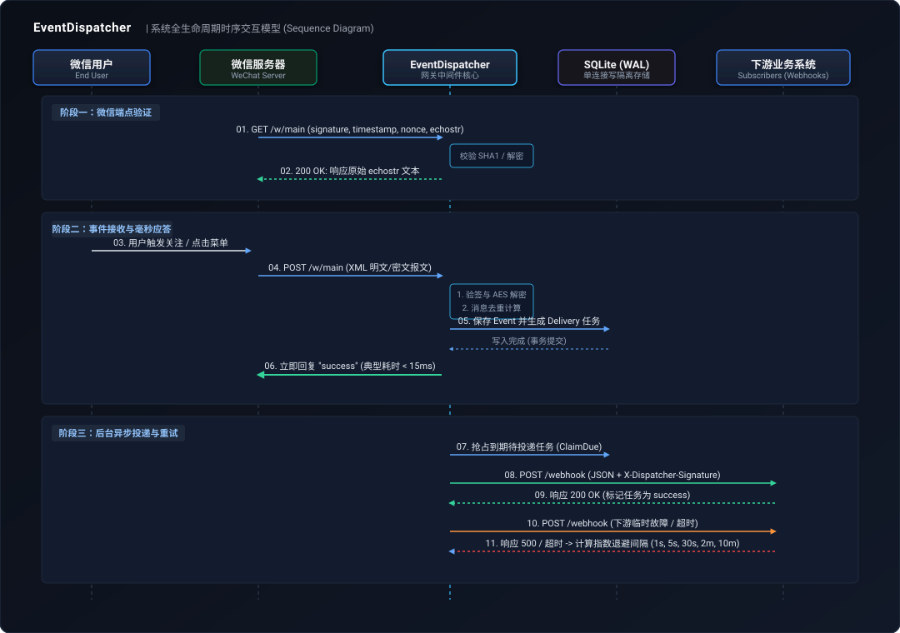

# EventDispatcher 对外接口与集成规范文档

本文档定义了 **EventDispatcher (微信公众号事件分发中心)** 的对外通信标准，包括微信网关接入协议、下游订阅方 Webhook 对接协议（含多语言验签示例）、Admin 管理接口体系及系统健康检查。

---

## 目录
- [1. 系统时序交互模型](#1-系统时序交互模型)
- [2. 通用交互约定](#2-通用交互约定)
  - [2.1 认证机制](#21-认证机制)
  - [2.2 统一响应结构](#22-统一响应结构)
  - [2.3 业务错误码字典](#23-业务错误码字典)
- [3. 微信公众号网关接入 (Ingest API)](#3-微信公众号网关接入-ingest-api)
  - [3.1 微信服务器地址验证 (GET)](#31-微信服务器地址验证-get)
  - [3.2 微信事件/消息推送接收 (POST)](#32-微信事件消息推送接收-post)
- [4. 下游系统 Webhook 协议 (Deliver Protocol)](#4-下游系统-webhook-协议-deliver-protocol)
  - [4.1 投递请求规范与 Headers](#41-投递请求规范与-headers)
  - [4.2 统一事件载荷 (Payload Schema)](#42-统一事件载荷-payload-schema)
  - [4.3 HMAC-SHA256 签名机制与各语言验签代码](#43-hmac-sha256-签名机制与各语言验签代码)
  - [4.4 指数退避重试与幂等建议](#44-指数退避重试与幂等建议)
- [5. 管理后台接口 (Admin API)](#5-管理后台接口-admin-api)
  - [5.1 微信服务号管理 (Accounts)](#51-微信服务号管理-accounts)
  - [5.2 订阅方与路由规则管理 (Subscribers)](#52-订阅方与路由规则管理-subscribers)
  - [5.3 事件日志查询 (Events)](#53-事件日志查询-events)
  - [5.4 投递任务查询与重试 (Deliveries)](#54-投递任务查询与重试-deliveries)
- [6. 健康检查接口 (Health Check)](#6-健康检查接口-health-check)

---

## 1. 系统时序交互模型

<p align="center">
  
</p>

---

## 2. 通用交互约定

### 2.1 认证机制
除健康检查 `/healthz` 与微信接收端点 `/w/{accountKey}` 外，所有 `/admin/*` 接口均采用 HTTP Bearer Token 机制认证：
```http
Authorization: Bearer <ADMIN_TOKEN>
```
服务端使用恒定时间比对算法（Constant Time Compare）检验 Token，杜绝时序攻击。

### 2.2 统一响应结构
所有管理端 API 均返回统一封装的标准 JSON：

#### 成功响应
```json
{
  "code": 0,
  "message": "success",
  "data": { ... },
  "traceId": "9f8a7b6c5d4e..."
}
```

#### 错误响应
```json
{
  "code": 40001,
  "message": "请求参数错误: callbackUrl 格式非法",
  "data": null,
  "traceId": "9f8a7b6c5d4e..."
}
```

每个响应均包含全局唯一的 `traceId`，并在 HTTP 响应头 `X-Trace-Id` 中回显，便于在日志系统中全链路检索。

### 2.3 业务错误码字典

| 业务错误码 (code) | HTTP 状态码 | 错误常量 | 描述 |
| :--- | :--- | :--- | :--- |
| `0` | 200 / 201 | `Success` | 操作执行成功 |
| `40001` | 400 | `ErrInvalidParam` | 请求参数缺失、格式错误或取值超出范围 |
| `40002` | 413 | `ErrPayloadTooLarge`| 请求载荷大小超过单次限制 (1MB) |
| `40101` | 401 | `ErrUnauthorized` | 未提供 Authorization 凭证或 Bearer Token 无效 |
| `40401` | 404 | `ErrNotFound` | 指定 ID 或 accountKey 的目标资源不存在 |
| `40901` | 409 | `ErrConflict` | 资源冲突（如 accountKey 已存在） |
| `42001` | 401 | `ErrWeChatBadSignature`| 微信消息或 URL 签名校验失败 |
| `42002` | 400 | `ErrWeChatDecryptFail` | 微信安全模式密文解密失败 |
| `42003` | 400 | `ErrWeChatMissingKey`  | 服务号未配置 EncodingAESKey，无法解密密文 |
| `42004` | 400 | `ErrWeChatBadXML`      | 微信上报内容不是合法的 XML 报文 |
| `50001` | 500 | `ErrInternalServer`    | 系统内部运行时错误 |
| `50301` | 503 | `ErrServiceUnavailable` | 存储引擎或数据库连通性不可用 |

---

## 3. 微信公众号网关接入 (Ingest API)

在微信公众平台后台（设置与开发 -> 基本配置 -> 服务器配置），将 **URL** 设置为：
`https://<你的域名>/w/<accountKey>`

其中 `<accountKey>` 为已在分发中心登记的服务号唯一标识（例如 `main`）。

### 3.1 微信服务器地址验证 (GET)
- **请求方式**：`GET`
- **请求路径**：`/w/{accountKey}`
- **Query 参数**：
  - `signature` (string, 必填)：微信加密签名；
  - `timestamp` (string, 必填)：时间戳；
  - `nonce` (string, 必填)：随机数；
  - `echostr` (string, 必填)：随机字符串；
  - `encrypt_type` (string, 可选)：值为 `aes` 时表示安全模式；
  - `msg_signature` (string, 可选)：安全模式下的消息签名。
- **返回结果**：
  - 成功：HTTP 200，内容为校验/解密后的原始 `echostr` 纯文本字符串；
  - 失败：返回对应的 HTTP 400 / 401 纯文本提示。

### 3.2 微信事件/消息推送接收 (POST)
- **请求方式**：`POST`
- **请求路径**：`/w/{accountKey}`
- **Content-Type**：`text/xml`
- **处理行为**：
  1. 支持明文、兼容以及 AES 安全模式；
  2. 自动校验签名并完成解密；
  3. 基于 `MsgId` 或 `AppID + FromUserName + CreateTime + Event + EventKey` 生成防重键进行全局幂等校验；
  4. 解析并入库后，**立即向微信回复文本 `success`**，避免微信长连接 5 秒超时重试；
  5. 真正的投递过程完全由后台异步 Worker 承载。

---

## 4. 下游系统 Webhook 协议 (Deliver Protocol)

### 4.1 投递请求规范与 Headers
分发中心向各下游订阅方注册的 `callbackUrl` 发送 HTTP `POST` 请求。

**必须校验的 Headers**：
| 请求头 | 说明 | 示例 |
| :--- | :--- | :--- |
| `Content-Type` | 统一为 JSON | `application/json` |
| `User-Agent` | 网关标识 | `event-dispatcher/1` |
| `X-Dispatcher-Event-Id` | 事件全局唯一 ID | `evt_01JBN6G...` |
| `X-Dispatcher-Timestamp` | 发起投递的秒级时间戳字符串 | `1730874600` |
| `X-Dispatcher-Signature` | 请求体 HMAC-SHA256 签名（小写十六进制） | `8b072d9e...` |

### 4.2 统一事件载荷 (Payload Schema)
```json
{
  "id": "evt_01JBN6G123456789ABCDEF0123",
  "accountKey": "main",
  "appId": "wx1234567890abcdef",
  "msgType": "event",
  "event": "CLICK",
  "eventKey": "MENU_HELP",
  "fromUser": "oXv6u0-dummy-openid",
  "toUser": "gh_123456789abc",
  "createTime": 1730874590,
  "receivedAt": "2026-11-06T06:29:50Z",
  "fields": {
    "ToUserName": "gh_123456789abc",
    "FromUserName": "oXv6u0-dummy-openid",
    "CreateTime": "1730874590",
    "MsgType": "event",
    "Event": "CLICK",
    "EventKey": "MENU_HELP"
  }
}
```

**字段释义**：
- `id` (string)：事件唯一主键。**下游建议使用该值建立业务幂等表**；
- `accountKey` (string)：在分发中心登记的服务号 Key；
- `appId` (string)：微信 AppID；
- `msgType` (string)：消息类型（`event`、`text`、`image`、`voice` 等）；
- `event` (string)：事件类型（`CLICK`、`VIEW`、`subscribe`、`unsubscribe` 等，仅在 `msgType == "event"` 时有值）；
- `eventKey` (string)：事件附加键（菜单 Key 或带参数二维码的场景值）；
- `fromUser` (string)：发送方用户 OpenID；
- `toUser` (string)：公众号微信号；
- `createTime` (int64)：微信上报的时间戳（秒）；
- `receivedAt` (string)：网关接收并解析事件的 ISO 8601 UTC 时间；
- `fields` (object)：保留了微信 XML 解密后的所有原始键值，需要扩展字段（如经纬度、图片链接、MediaId）时直接在其中提取。

### 4.3 HMAC-SHA256 签名机制与各语言验签代码

#### 签名计算公式
$$\text{Signature} = \text{hex}(\text{HMAC-SHA256}(\text{secret}, \text{timestamp} + \text{"."} + \text{rawBody}))$$

> **安全警告**：验签时必须直接读取网络连接流中的**原始字节切片（Raw Body）**。严禁将请求体反序列化为对象后再重新序列化计算签名，因为 JSON 字段顺序、转义符和空白字符差异必然导致签名比对失败。

#### 各语言验签实现参考

##### Go 语言
```go
package main

import (
	"crypto/hmac"
	"crypto/sha256"
	"crypto/subtle"
	"encoding/hex"
	"io"
	"net/http"
)

func VerifySignature(r *http.Request, secret string) ([]byte, bool) {
	sig := r.Header.Get("X-Dispatcher-Signature")
	ts := r.Header.Get("X-Dispatcher-Timestamp")
	if sig == "" || ts == "" {
		return nil, false
	}
	body, err := io.ReadAll(r.Body)
	if err != nil {
		return nil, false
	}
	mac := hmac.New(sha256.New, []byte(secret))
	mac.Write([]byte(ts + "."))
	mac.Write(body)
	expected := hex.EncodeToString(mac.Sum(nil))

	return body, subtle.ConstantTimeCompare([]byte(sig), []byte(expected)) == 1
}
```

##### Python (FastAPI / Flask)
```python
import hmac
import hashlib

def verify_signature(secret: str, timestamp: str, raw_body: bytes, expected_sig: str) -> bool:
    if not timestamp or not expected_sig:
        return False
    payload = timestamp.encode("utf-8") + b"." + raw_body
    computed = hmac.new(secret.encode("utf-8"), payload, hashlib.sha256).hexdigest()
    return hmac.compare_digest(computed.lower(), expected_sig.lower())
```

##### Java (Spring Boot)
```java
import javax.crypto.Mac;
import javax.crypto.spec.SecretKeySpec;
import java.nio.charset.StandardCharsets;
import java.security.MessageDigest;

public class WebhookVerifier {
    public static boolean verify(String secret, String timestamp, byte[] rawBody, String expectedSig) {
        if (timestamp == null || expectedSig == null) return false;
        try {
            Mac mac = Mac.getInstance("HmacSHA256");
            mac.init(new SecretKeySpec(secret.getBytes(StandardCharsets.UTF_8), "HmacSHA256"));
            mac.update((timestamp + ".").getBytes(StandardCharsets.UTF_8));
            mac.update(rawBody);
            byte[] hash = mac.doFinal();

            StringBuilder sb = new StringBuilder();
            for (byte b : hash) {
                sb.append(String.format("%02x", b));
            }
            return MessageDigest.isEqual(sb.toString().getBytes(StandardCharsets.UTF_8),
                                        expectedSig.toLowerCase().getBytes(StandardCharsets.UTF_8));
        } catch (Exception e) {
            return false;
        }
    }
}
```

##### Node.js (Express)
```javascript
const crypto = require('crypto');

function verifySignature(secret, timestamp, rawBodyBuffer, expectedSig) {
    if (!timestamp || !expectedSig) return false;
    const hmac = crypto.createHmac('sha256', secret);
    hmac.update(timestamp + '.');
    hmac.update(rawBodyBuffer);
    const computed = hmac.digest('hex');
    return crypto.timingSafeEqual(Buffer.from(computed), Buffer.from(expectedSig));
}
```

##### PHP
```php
function verifyDispatcherSignature($secret, $timestamp, $rawBody, $expectedSig) {
    if (empty($timestamp) || empty($expectedSig)) {
        return false;
    }
    $payload = $timestamp . '.' . $rawBody;
    $computed = hash_hmac('sha256', $payload, $secret);
    return hash_equals($computed, strtolower($expectedSig));
}
```

### 4.4 指数退避重试与幂等建议
- **成功判断**：下游 Webhook 响应 HTTP `2xx` 状态码（如 `200`、`204`）即视为投递成功。
- **重试机制**：当下游返回非 2xx 状态码或请求超时（默认 3 秒超时）时，调度器自动进行阶梯退避重试：
  - 最大重试次数默认为 6 次；
  - 间隔梯度为：`1秒` -> `5秒` -> `30秒` -> `2分钟` -> `10分钟`；
  - 超过最大次数后任务标记为 `failed`，需通过 Admin 接口手动重放。
- **业务幂等**：由于网络超时或重试机制，下游可能收到多次同一事件。下游系统必须使用请求体中的 `id`（例如 `evt_01JBN...`）建立排重表。

---

## 5. 管理后台接口 (Admin API)

请求头必须携带：
`Authorization: Bearer <ADMIN_TOKEN>`

### 5.1 微信服务号管理 (Accounts)

#### 创建服务号
- **POST** `/admin/accounts`
- **请求体**：
  ```json
  {
    "name": "企业官方主服务号",
    "accountKey": "main",
    "appId": "wx1234567890abcdef",
    "token": "your-wechat-token-value",
    "encodingAesKey": "abcdefghijklmnopqrstuvwxyz0123456789ABCDEFG"
  }
  ```
  - `name` (string, 必填)：服务号名称（1~64 字符）；
  - `accountKey` (string, 必填)：URL 唯一路由标识，只允许字母、数字、下划线和连字符；
  - `appId` (string, 必填)：微信 AppID；
  - `token` (string, 必填)：微信 Token（3~32 字符）；
  - `encodingAesKey` (string, 可选)：微信 43 位密钥（开启安全模式时必填）。
- **响应 (201 Created)**：
  ```json
  {
    "code": 0,
    "message": "created",
    "data": {
      "id": "acc_01JBN6G...",
      "name": "企业官方主服务号",
      "accountKey": "main",
      "appId": "wx1234567890abcdef",
      "tokenSet": true,
      "encodingAesKeySet": true,
      "createdAt": "2026-11-06T06:00:00Z",
      "updatedAt": "2026-11-06T06:00:00Z"
    },
    "traceId": "a1b2c3d4..."
  }
  ```

#### 获取服务号列表
- **GET** `/admin/accounts`
- **响应 (200 OK)**：
  ```json
  {
    "code": 0,
    "message": "success",
    "data": {
      "items": [
        {
          "id": "acc_01JBN6G...",
          "name": "企业官方主服务号",
          "accountKey": "main",
          "appId": "wx1234567890abcdef",
          "tokenSet": true,
          "encodingAesKeySet": true,
          "createdAt": "2026-11-06T06:00:00Z",
          "updatedAt": "2026-11-06T06:00:00Z"
        }
      ]
    },
    "traceId": "a1b2c3d4..."
  }
  ```

#### 获取服务号详情
- **GET** `/admin/accounts/{id}`

#### 更新服务号
- **PUT** `/admin/accounts/{id}`
- **说明**：支持部分字段覆盖。若不传 `token` 或 `encodingAesKey` 则保留原有凭证。

#### 删除服务号
- **DELETE** `/admin/accounts/{id}`
- **说明**：级联删除该服务号下的所有订阅者、事件记录与投递任务。
- **响应 (204 No Content)**。

---

### 5.2 订阅方与路由规则管理 (Subscribers)

#### 创建订阅方
- **POST** `/admin/subscribers`
- **请求体**：
  ```json
  {
    "name": "业务菜单交互程序",
    "accountId": "acc_01JBN6G...",
    "callbackUrl": "https://api.internal/webhook/wechat",
    "secret": "your-webhook-hmac-secret",
    "enabled": true,
    "timeoutMs": 3000,
    "maxAttempts": 6,
    "filter": {
      "msgTypes": ["event"],
      "events": ["CLICK"],
      "eventKeyPrefixes": ["MENU_"]
    }
  }
  ```
  - `accountId` (string, 必填)：所属服务号 ID；
  - `callbackUrl` (string, 必填)：接收投递的 HTTP/HTTPS Webhook 地址；
  - `secret` (string, 必填)：HMAC-SHA256 签名密钥（1~256 字符）；
  - `timeoutMs` (int, 选填，默认 3000)：单次投递超时毫秒数（100~30000）；
  - `maxAttempts` (int, 选填，默认 6)：失败最大重试次数（1~10）；
  - `filter` (object, 选填)：路由过滤规则。不传或传空对象 `{}` 表示订阅该服务号的全量事件。
- **响应 (201 Created)**：
  ```json
  {
    "code": 0,
    "message": "created",
    "data": {
      "id": "sub_01JBN7A...",
      "accountId": "acc_01JBN6G...",
      "name": "业务菜单交互程序",
      "callbackUrl": "https://api.internal/webhook/wechat",
      "secretSet": true,
      "enabled": true,
      "timeoutMs": 3000,
      "maxAttempts": 6,
      "filter": {
        "msgTypes": ["event"],
        "events": ["CLICK"],
        "eventKeyPrefixes": ["MENU_"]
      },
      "createdAt": "2026-11-06T06:05:00Z",
      "updatedAt": "2026-11-06T06:05:00Z"
    },
    "traceId": "a1b2c3d4..."
  }
  ```

#### 获取订阅方列表
- **GET** `/admin/subscribers?accountId={accountId}`
- **Query 参数**：`accountId`（选填，过滤特定账号下的订阅方）。

#### 获取订阅方详情
- **GET** `/admin/subscribers/{id}`

#### 更新订阅方
- **PUT** `/admin/subscribers/{id}`
- **说明**：可修改 `name`、`callbackUrl`、`secret`、`enabled`、`timeoutMs`、`maxAttempts`、`filter`。若不传递 `secret` 则保留原值。

#### 删除订阅方
- **DELETE** `/admin/subscribers/{id}`
- **响应 (204 No Content)**。

---

### 5.3 事件日志查询 (Events)

#### 查询事件列表
- **GET** `/admin/events?accountId={accountId}&limit={limit}`
- **Query 参数**：
  - `accountId`（选填）：筛选服务号；
  - `limit`（选填，默认 50，最大 200）。
- **响应 (200 OK)**：
  ```json
  {
    "code": 0,
    "message": "success",
    "data": {
      "items": [
        {
          "id": "evt_01JBN8B...",
          "accountId": "acc_01JBN6G...",
          "dedupeKey": "msgid_1234567890",
          "msgType": "event",
          "event": "CLICK",
          "eventKey": "MENU_HELP",
          "fromUser": "oXv6u0-openid",
          "toUser": "gh_123456",
          "createTime": 1730874590,
          "receivedAt": "2026-11-06T06:29:50Z",
          "payload": { ... }
        }
      ]
    },
    "traceId": "a1b2c3d4..."
  }
  ```

#### 查询单条事件详情
- **GET** `/admin/events/{id}`

---

### 5.4 投递任务查询与重试 (Deliveries)

#### 查询投递任务列表
- **GET** `/admin/deliveries?eventId={eventId}&status={status}&limit={limit}`
- **Query 参数**：
  - `eventId`（选填）：指定事件 ID；
  - `status`（选填）：可选值包括 `pending`、`inflight`、`success`、`failed`；
  - `limit`（选填，默认 50，最大 200）。
- **响应 (200 OK)**：
  ```json
  {
    "code": 0,
    "message": "success",
    "data": {
      "items": [
        {
          "id": "dlv_01JBN9C...",
          "eventId": "evt_01JBN8B...",
          "subscriberId": "sub_01JBN7A...",
          "subscriberName": "业务菜单交互程序",
          "status": "failed",
          "attempt": 6,
          "nextRetryAt": "2026-11-06T06:40:00Z",
          "lastStatusCode": 500,
          "lastError": "http status 500: Database Connection Timeout",
          "updatedAt": "2026-11-06T06:40:00Z"
        }
      ]
    },
    "traceId": "a1b2c3d4..."
  }
  ```

#### 查询单条投递任务详情
- **GET** `/admin/deliveries/{id}`

#### 手动触发重试
- **POST** `/admin/deliveries/{id}/retry`
- **说明**：将处于 `failed` 或其他状态的任务状态重置为 `pending`，并把重试等待时间拉回当前时间，调度 Worker 会在 500ms 周期内立即尝试重新投递。
- **响应 (200 OK)**：返回重置后的任务对象。

---

## 6. 健康检查接口 (Health Check)

- **GET** `/healthz`
- **鉴权要求**：公开接口，无需任何 Authorization 标头。
- **响应**：
  - 正常 (HTTP 200)：
    ```json
    {
      "code": 0,
      "message": "success",
      "data": { "status": "ok" },
      "traceId": "a1b2c3d4..."
    }
    ```
  - 异常 (HTTP 503)：存储连接不可用。
    ```json
    {
      "code": 50301,
      "message": "数据库连接不可用",
      "data": null,
      "traceId": "a1b2c3d4..."
    }
    ```
