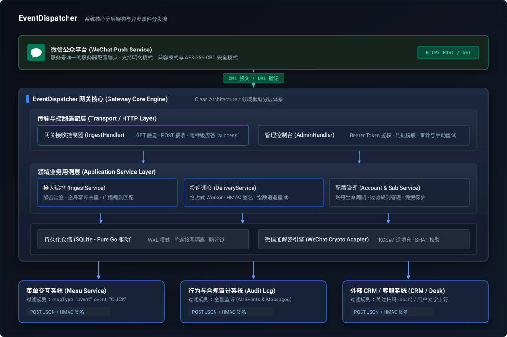
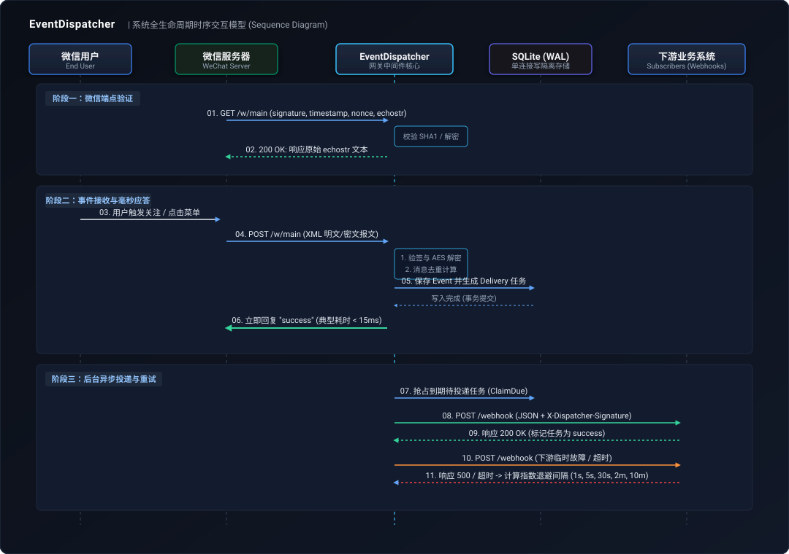

# EventDispatcher 系统架构与设计文档

本文档深入解析 EventDispatcher 的内部架构设计、分层模型、数据流转以及高并发保障机制。

---

## 1. 整体架构图

<p align="center">
  
</p>

---

## 2. 核心分层设计 (Clean Architecture)

项目严格遵循整洁架构规范，确保领域规则、业务用例与外部框架彻底解耦：

```text
├── internal/
│   ├── domain/               # 领域层：纯业务实体、值对象、过滤器匹配规则（零外部依赖）
│   ├── service/              # 业务层：接入编排(Ingest)、投递调度(Delivery)、账号/订阅管理
│   ├── infrastructure/       # 基础设施层：纯 Go SQLite WAL 驱动、微信加解密协议实现
│   └── transport/http/       # 传输层：RESTful HTTP API、安全中间件、嵌入式 Web 控制台
```

### 核心设计原则
1. **单向依赖**：内层（Domain）绝不依赖外层（Transport/Infrastructure），所有数据访问依赖 Repository 接口。
2. **读写分离与 WAL 模式**：
   - SQLite 默认开启 WAL（Write-Ahead Logging）模式，实现读并发不被写阻塞。
   - 写入通道采用专用单连接池隔离，彻底避免多线程并发下的 `SQLITE_BUSY` 与 `database is locked` 锁竞争。
3. **极速应答机制**：
   - 微信推送事件后，网关仅做合法性校验、幂等去重和初始持久化，并在 15ms 内立即向微信回复 `success`。
   - 下游业务系统的分发、过滤、出站签名与重试完全移交异步 Worker 处理，杜绝因下游业务慢而导致微信 5 秒超时重发。

---

## 3. 事件流转与时序图

<p align="center">
  
</p>

### 关键流转步骤
1. **微信事件接入**：微信服务器向 `/w/{accountKey}` 推送 XML 报文。
2. **安全验签与逆填充**：根据服务号绑定的 Token 验证 SHA-1 签名，安全模式下执行 AES-256-CBC 解密及 PKCS#7 逆填充。
3. **全局防重幂等**：提取微信消息中的 `MsgId` 或 `FromUserName + CreateTime` 计算防重指纹。若已存在，直接返回 `success`，不重复分发。
4. **规则路由分流**：遍历该服务号下的活跃订阅方，通过 JSON Filter 评估规则（包含 `msgTypes`、`events`、`eventKeyPrefixes`）。
5. **投递调度 Worker**：后台 Worker 定时批量扫描就绪的投递任务，生成带有 HMAC-SHA256 出站签名的 JSON 载荷，向业务方 Webhook 投递。
6. **阶梯退避重试**：遇到下游超时或非 2xx 响应时，按指数退避算法更新 `next_retry_at`，等待下一轮调度。
